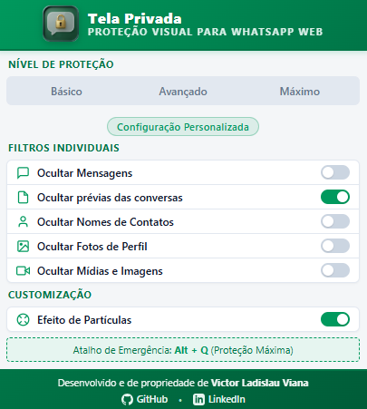
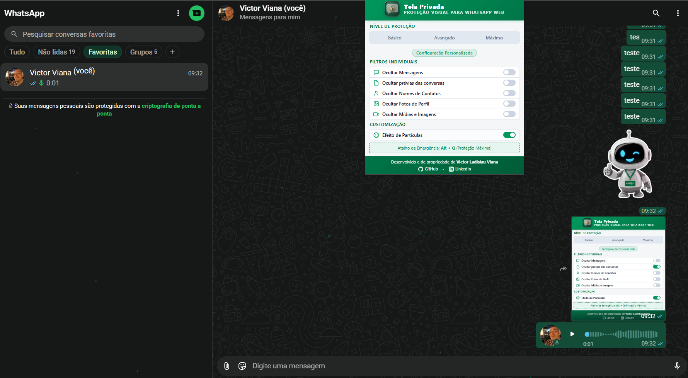
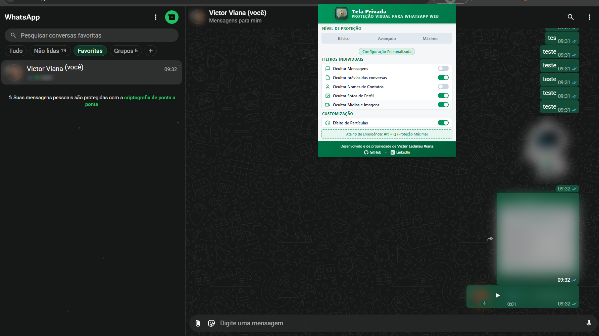
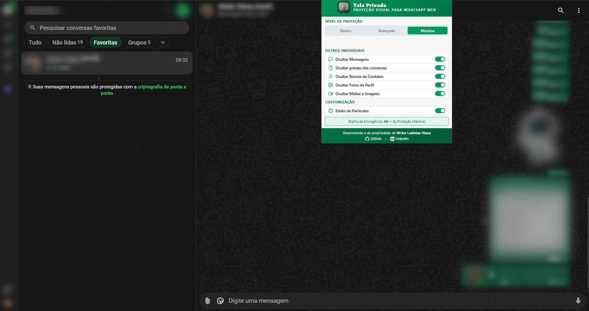

# Tela Privada

**Proteção visual para WhatsApp Web.**

O Tela Privada é uma extensão de navegador que ajuda a manter conversas e informações visíveis apenas para você, reduzindo a exposição da tela a olhares curiosos em escritórios, coworkings, cafés, espaços públicos e outros ambientes compartilhados.

  <a href="https://chromewebstore.google.com/detail/tela-privada/pcaaiadmbhddaialecemcinlocbilkho"><strong>Instalar no Chrome</strong></a>
  ·
  <a href="https://microsoftedge.microsoft.com/addons/detail/tela-privada/mgnaaflndjbiigpaicibclncajhopedm"><strong>Instalar no Microsoft Edge</strong></a>

> **Disponível oficialmente:** o Tela Privada já foi publicado na Chrome Web Store e na Microsoft Edge Add-ons.

## Proteja o que aparece na sua tela

O Tela Privada aplica efeitos visuais locais à interface do WhatsApp Web. Você escolhe o que deseja ocultar e o nível de proteção adequado ao ambiente.

### Recursos principais

- **Mensagens:** desfoca o conteúdo das conversas abertas.
- **Prévias:** oculta trechos de mensagens exibidos na lista de conversas.
- **Nomes e contatos:** desfoca nomes, títulos e números de telefone.
- **Fotos e avatares:** reduz a exposição de imagens de perfil.
- **Mídias e documentos:** oculta visualmente fotos, vídeos, GIFs, figurinhas, áudios e documentos compatíveis.
- **Revelação sob demanda:** permite revelar temporariamente elementos protegidos ao posicionar o cursor sobre eles em dispositivos compatíveis.
- **Censura por inatividade:** aplica uma camada visual de proteção quando você se afasta do computador, com tempo e efeito configuráveis.
- **Atalho de emergência:** use `Alt + Q` para alternar rapidamente a proteção máxima e retornar à configuração anterior.
- **Idiomas:** interface disponível em português do Brasil, inglês e espanhol.

### Escolha seu nível de proteção

| Perfil | Como funciona |
| --- | --- |
| **Básico** | Protege mensagens e prévias. |
| **Avançado** | Acrescenta a proteção de mídias. |
| **Máximo** | Também oculta nomes e fotos de perfil. |
| **Personalizado** | Permite combinar os filtros individualmente. |

## Veja o Tela Privada em funcionamento

As imagens abaixo são capturas reais do produto mantidas no repositório.

| Painel de controles | Mensagens protegidas |
| --- | --- |
|  |  |

| Painel integrado ao WhatsApp Web | Proteção visual ampliada |
| --- | --- |
|  |  |

## Privacidade como princípio

O Tela Privada foi desenvolvido para atuar na apresentação visual da página, não como um mecanismo de leitura ou processamento de conversas.

- As preferências são armazenadas localmente no navegador por meio de `chrome.storage.local`.
- O projeto declara não coletar conteúdo de mensagens nem enviar telemetria.
- O manifesto solicita a permissão `storage`; o atalho de emergência utiliza a API de comandos do navegador.
- A integração de conteúdo é restrita ao endereço do WhatsApp Web.

Consulte a [Política de Privacidade](docs/PRIVACY_POLICY.md) para conhecer o detalhamento sobre dados, permissões e limitações.

## Compatibilidade

- **Google Chrome:** disponível na Chrome Web Store.
- **Microsoft Edge:** disponível na Microsoft Edge Add-ons.
- **Plataforma protegida:** WhatsApp Web (`web.whatsapp.com`).

O suporte funcional atual é exclusivo para o WhatsApp Web. Integrações com outras plataformas não fazem parte da versão publicada.

## Instalação para desenvolvimento

Se você deseja executar ou contribuir com o projeto:

1. Clone este repositório.
2. Abra a página de extensões do navegador (`chrome://extensions/` ou `edge://extensions/`).
3. Ative o **Modo do desenvolvedor**.
4. Selecione **Carregar sem compactação** e escolha a pasta do projeto que contém o `manifest.json`.
5. Abra o WhatsApp Web.

Instruções detalhadas estão em [Desenvolvimento e instalação local](docs/DEVELOPMENT.md).

## Documentação

- [Arquitetura e módulos](docs/ARCHITECTURE.md)
- [Testes e validação](docs/TESTING.md)
- [Desenvolvimento e instalação local](docs/DEVELOPMENT.md)
- [Política de Privacidade](docs/PRIVACY_POLICY.md)
- [Ficha de publicação da Chrome Web Store](docs/CHROME_WEB_STORE_LISTING.md)

## Autoria e propriedade

Desenvolvido e de propriedade de **Victor Ladislau Viana**.

- [GitHub](https://github.com/Invictor13)
- [LinkedIn](https://www.linkedin.com/in/victor-ladislau-14402a170/)
- [Repositório do projeto](https://github.com/Invictor13/Extensao_Conversa_Segura)

## Aviso legal

O Tela Privada é um projeto independente e não possui vínculo, afiliação ou endosso da Meta Platforms, Inc. WhatsApp é uma marca de sua respectiva titular. A proteção oferecida é visual: não substitui criptografia, não impede capturas de tela ou fotografias externas e não protege o dispositivo contra malware, spyware ou keyloggers.

---

**Versão do código:** 2.0.3 · **Manifest:** V3
